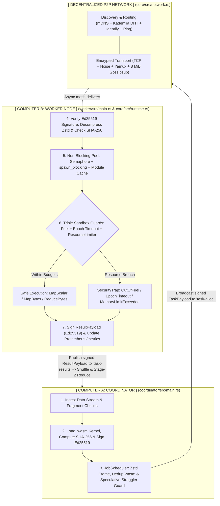
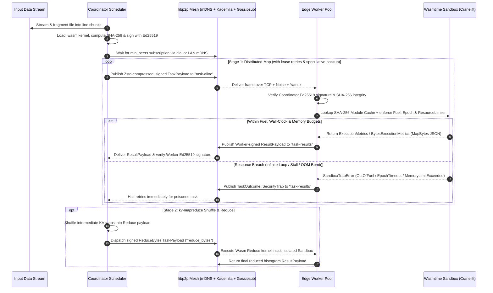

<div align="center">

# NITRO COMPUTE

### Decentralized P2P Serverless MapReduce Engine at the Edge

*Compile compute kernels into lightweight, sandboxed WebAssembly modules and orchestrate ultra-low latency big data workloads across an encrypted, cryptographically attested peer-to-peer mesh.*

[](https://www.rust-lang.org/)
[]-0E8A16?style=for-the-badge)](./SECURITY.md)
[](https://wasmtime.dev/)
[](https://libp2p.io/)
[](./core/src/metrics.rs)
[](https://wasi.dev/)

---

[**Architecture**](#end-to-end-execution-pipeline) •
[**Security & Resource Guards**](#zero-trust-sandbox--deterministic-resource-guards) •
[**P2P & Crypto Protocol**](#decentralized-p2p--cryptographic-protocol) •
[**Observability & Benchmarks**](#observability--reproducible-benchmarks) •
[**Workspace**](#workspace-architecture) •
[**Quick Start**](#quick-start--deployment) •
[**CLI Reference**](#cli-reference)

</div>

---

## Overview

**Nitro Compute** is a high-performance, decentralized serverless MapReduce compute engine built in **100% memory-safe host Rust** (`#![forbid(unsafe_code)]` across `core`, `coordinator`, and `worker`). Rather than transferring raw datasets to centralized cloud clusters or booting heavyweight containers, Nitro Compute compiles stateless **Map** and **Reduce** kernels into compact **`wasm32-wasip1` WebAssembly bytecode** (~13 KB – 80 KB), compresses wire payloads with **Zstandard**, signs tasks end-to-end with **Ed25519**, and orchestrates parallel execution across an encrypted **`libp2p` mesh network**.

Idle edge nodes (**Workers**) auto-discover peers via **LAN mDNS** or **Kademlia DHT**, verify Coordinator **Ed25519** signatures and **SHA-256** bytecode integrity, execute cached **Wasmtime (Cranelift)** sandboxes inside non-blocking bounded thread pools enforced by **triple-layer resource limits** (Instruction Fuel Metering, Preemptive Wall-Clock Epoch Interruption, and `ResourceLimiter` Memory/Table bounds), and expose real-time **Prometheus `/metrics`** and **`/healthz`** HTTP endpoints.

### Architectural Highlights

| Capability | Traditional Cloud MapReduce | Containerized Edge Workers | **Nitro Compute (`v0.3.0`)** |
| :--- | :--- | :--- | :--- |
| **Host Memory Safety** | JVM / Managed Runtime | Go / C++ container shims | **`#![forbid(unsafe_code)]` across all host crates** |
| **Cold-Start Latency** | Seconds to Minutes | Hundreds of milliseconds | **Sub-millisecond (SHA-256 Cached Cranelift JIT)** |
| **Compute Model** | Rigid centralized pipelines | Stateless HTTP requests | **True 2-Phase Wasm Map -> Shuffle -> Wasm Reduce** |
| **Straggler Mitigation** | Static timeouts | Manual retries | **Google MapReduce Speculative Backup Execution** |
| **Untrusted Code Isolation** | OS-level VM / Container | Namespace / cgroups | **WASI + Fuel Metering + Epoch Interrupt + `ResourceLimiter`** |
| **Cryptographic Provenance** | IAM / Perimeter TLS | mTLS Gateway | **Noise Transport + Ed25519 Task & Result Attestation** |
| **Wire Efficiency** | Uncompressed / Batch RPC | HTTP/JSON overhead | **Zstd (`NZST`) Compression + SHA-256 Wasm Deduplication** |
| **Observability** | External sidecar agents | Vendor agents | **Built-in Prometheus `/metrics` & `/healthz` HTTP Server** |

---

## End-to-End Execution Pipeline

### System Dataflow Blueprint



### Two-Phase MapReduce Sequence Diagram



---

## Zero-Trust Sandbox & Deterministic Resource Guards

Executing network-delivered compute kernels on untrusted edge peers requires rigorous compile-time and runtime guarantees. Inside [`core/src/runtime.rs`](./core/src/runtime.rs), `NitroRuntime` enforces five defense-in-depth layers:

1. **Zero `unsafe` Host Runtime (`#![forbid(unsafe_code)]`)**:
   - All host crates (`nitro_core`, `coordinator`, `worker`) disallow `unsafe` code at compile time.
2. **Instruction-Level Fuel Metering (`Trap::OutOfFuel`)**:
   - `config.consume_fuel(true)` + `store.add_fuel(fuel_limit)?` deterministically aborts CPU infinite loops (`SandboxTrapError::OutOfFuel`).
3. **Preemptive Wall-Clock Epoch Interruption (`Trap::Interrupt`)**:
   - `config.epoch_interruption(true)` paired with a managed `EpochTicker` (`10 ms` tick) enforces wall-clock deadlines via `store.set_epoch_deadline(ticks)` (`SandboxTrapError::EpochTimeout`).
4. **Linear Memory, Table & Output Caps (`ResourceLimiter`)**:
   - `SandboxLimiter` bounds linear memory (`64 MiB` default) and table growth (`10,000` elements) before host allocation (`SandboxTrapError::MemoryLimitExceeded`, `TableLimitExceeded`).
   - Variable-length `(ptr, len) -> i64` outputs enforce `out_len <= max_output_bytes` (`4 MiB` default) and bounds-checked `Memory::read`.
5. **Capability-Based WASI Isolation & SHA-256 Module Cache**:
   - Fresh `WasiP1Ctx` per invocation with zero preopened host directories, backed by an LRU-evicting SHA-256 compiled `Module` cache.

```rust
// core/src/runtime.rs
let mut config = Config::new();
config.strategy(Strategy::Cranelift);
config.cranelift_opt_level(OptLevel::Speed);
config.consume_fuel(true);
config.epoch_interruption(true);
```

---

## Decentralized P2P & Cryptographic Protocol

[`core/src/network.rs`](./core/src/network.rs) defines `NitroBehavior`, unifying **Kademlia DHT**, **Gossipsub**, **mDNS** (`Toggle<mdns::tokio::Behaviour>`), **Identify**, and **Ping**.

### Security, Compression & Framing
- **Transport**: Asynchronous TCP (`libp2p::tcp::tokio`) + **Noise** encryption + **Yamux** stream multiplexing
- **Wire Compression**: `NZST`-prefixed **Zstandard** compression with `8 MiB` Gossipsub `max_transmit_size` and a strict `16 MiB` bounded decompression limit against zip bombs
- **End-to-End Ed25519 Attestation**:
  - Persistent node identities via `--identity-key <PATH>` (protobuf-encoded Ed25519 `Keypair`)
  - Coordinators sign canonical task digests (`TaskPayload::sign`); Workers enforce allowlists with `--trusted-coordinator <PUBKEY_HEX>` / `--require-signed-tasks`
  - Workers sign result digests (`ResultPayload::sign`); Coordinators verify both the Ed25519 signature and that the signer key matches `worker_peer_id` (preventing PeerId spoofing)

### Pub/Sub Channels
- **`"task-alloc"`**: Dispatches signed `TaskPayload`s (`MapScalar`, `MapBytes`, `ReduceBytes`)
- **`"task-results"`**: Returns signed `ResultPayload`s (`Success`, `SecurityTrap`, `ExecutionError`) with `fuel_consumed`, `duration_us`, and `cache_hit`
- **`"worker-telemetry"`**: Broadcasts periodic `WorkerTelemetry` capacity & cache heartbeats

---

## Observability & Reproducible Benchmarks

### Prometheus `/metrics` & `/healthz` HTTP Endpoint

[`core/src/metrics.rs`](./core/src/metrics.rs) embeds a zero-dependency HTTP/1.1 observability server (`--metrics-addr 127.0.0.1:9091`) exposing:
- `GET /metrics`: Prometheus v0.0.4 exposition metrics (`nitro_tasks_completed_total`, `nitro_tasks_trapped_total{kind=...}`, `nitro_tasks_active`, `nitro_module_cache_hits_total`, `nitro_module_cache_misses_total`, `nitro_fuel_consumed_total`, `nitro_execution_duration_microseconds_total`, `nitro_speculative_backups_total`, `nitro_signature_failures_total`, `nitro_p2p_connected_peers`)
- `GET /healthz` / `/readyz`: JSON readiness probe (`status`, `peer_id`, `uptime_secs`, `active_tasks`, `connected_peers`)

### Running the Sandbox & Wire Benchmark Suite

Run the reproducible empirical benchmark (also executed in CI on every commit):
```bash
cargo run -p core --example bench_sandbox --release
```
Measures cold-start uncached JIT vs. SHA-256 warm-cache `p50`/`p95`/`p99` latency (microseconds), multi-threaded parallel throughput (`tasks/sec`), `OutOfFuel` trap latency, and Zstd wire compression ratios.

---

## Workspace Architecture

```text
nitro-compute/
├── Cargo.toml                  # Workspace manifest & shared dependency versions
├── Cargo.lock                  # Reproducible dependency lockfile
├── core/                       # Shared runtime, security, P2P & observability (`nitro_core`)
│   ├── Cargo.toml
│   ├── src/
│   │   ├── lib.rs              # #![forbid(unsafe_code)], exports & tracing setup
│   │   ├── runtime.rs          # NitroRuntime: Fuel, Epoch Interrupt, ResourceLimiter, SHA-256 Cache, Bytes ABI
│   │   ├── network.rs          # NitroBehavior: Kademlia, Gossipsub, mDNS, Identify, Ping, Ed25519, Zstd
│   │   └── metrics.rs          # Lock-free NitroTelemetryRegistry & Prometheus /metrics HTTP server
│   ├── examples/
│   │   └── bench_sandbox.rs    # Cold/warm p50/p95/p99 latency, throughput & Zstd benchmark
│   └── tests/
│       └── p2p_mapreduce.rs    # Live 2-Swarm Noise+Yamux signed E2E MapReduce & Trap test
├── coordinator/                # Fault-tolerant Coordinator CLI oracle (`#![forbid(unsafe_code)]`)
│   ├── Cargo.toml
│   └── src/main.rs             # Stream chunker, 2-phase scheduler, speculative straggler backup & /metrics
├── worker/                     # Non-blocking edge compute daemon (`#![forbid(unsafe_code)]`)
│   ├── Cargo.toml
│   └── src/main.rs             # Semaphore-bounded blocking pool, Ed25519 verification, cache & /metrics
└── jobs/
    ├── word-count/             # Scalar word-count Wasm kernel (`wasm32-wasip1`)
    ├── pattern-match/          # Multi-entrypoint log analyzer Wasm kernel (`wasm32-wasip1`)
    └── kv-wordcount/           # Two-phase JSON KV Map + Reduce Wasm kernel (`wasm32-wasip1`)
```

---

## Quick Start & Deployment

### Prerequisites
- **Rust Toolchain** (`rustc` & `cargo` 2021 edition)
- **WASI Preview 1 Target**:
  ```bash
  rustup target add wasm32-wasip1
  ```

### Step 1: Compile the WebAssembly Map & Reduce Kernels
```bash
cargo build --manifest-path jobs/word-count/Cargo.toml --target wasm32-wasip1 --release
cargo build --manifest-path jobs/pattern-match/Cargo.toml --target wasm32-wasip1 --release
cargo build --manifest-path jobs/kv-wordcount/Cargo.toml --target wasm32-wasip1 --release
```

### Step 2: Verify Lints, Tests & Release Binaries
```bash
cargo clippy --workspace --all-targets -- -D warnings
cargo test --workspace
cargo build --release
```

### Step 3: Start Hardened Edge Worker Daemons (with Prometheus Metrics)
```bash
RUST_LOG=info cargo run --release --bin worker -- \
  --listen /ip4/0.0.0.0/tcp/4001 \
  --identity-key ./worker.key \
  --metrics-addr 127.0.0.1:9091 \
  --max-concurrency 4 \
  --max-memory-mb 64
```

### Step 4: Run Two-Phase MapReduce (`kv-wordcount`) or Scalar Jobs from Coordinator
```bash
RUST_LOG=info cargo run --release --bin coordinator -- \
  --input input.txt \
  --wasm target/wasm32-wasip1/release/kv_wordcount.wasm \
  --mode kv-mapreduce \
  --dedup-wasm \
  --speculative \
  --verify-worker-sigs \
  --identity-key ./coordinator.key \
  --metrics-addr 127.0.0.1:9090 \
  --peer /ip4/127.0.0.1/tcp/4001 \
  --chunk-lines 5 \
  --fuel 10000000
```

To enforce Coordinator key pinning on Workers, pass the `coordinator_pubkey_hex` printed on Coordinator startup:
```bash
cargo run --release --bin worker -- \
  --trusted-coordinator <COORDINATOR_PUBKEY_HEX> \
  --listen /ip4/0.0.0.0/tcp/4001
```

---

## CLI Reference

### `coordinator` Flags

| Flag | Short | Default | Description |
| :--- | :---: | :--- | :--- |
| `--input <PATH>` | `-i` | `input.txt` | Path to the raw text stream file to fragment and process. |
| `--wasm <PATH>` | `-w` | Auto-detected | Explicit path to the compiled `.wasm` MapReduce module. |
| `--mode <MODE>` | — | `scalar` | Execution mode: `scalar` or `kv-mapreduce` (2-phase Map -> Shuffle -> Reduce). |
| `--entry-fn <NAME>` | `-e` | `map_line` / `map_bytes` | Exported Wasm function name to invoke during the Map phase. |
| `--reduce-fn <NAME>` | — | `reduce_bytes` | Exported Wasm function name for Stage-2 Reduce (`kv-mapreduce`). |
| `--dedup-wasm` | — | `false` | Omit `wasm_binary` on chunks `1..N` using SHA-256 references (with cache-miss fallback). |
| `--speculative` | — | `false` | Enable Google MapReduce speculative backup execution for straggler chunks. |
| `--identity-key <PATH>` | — | Ephemeral | Load or persist Coordinator Ed25519 identity keypair for signed tasks. |
| `--verify-worker-sigs` | — | `false` | Reject unsigned or spoofed `ResultPayload` responses. |
| `--metrics-addr <ADDR>` | — | Disabled | Bind HTTP server exposing Prometheus `/metrics` and `/healthz`. |
| `--listen <MULTIADDR>` | `-l` | `/ip4/0.0.0.0/tcp/0` | Local TCP multiaddr for the Coordinator node. |
| `--peer <MULTIADDR>` | `-p` | Auto (mDNS) | Worker peer multiaddr to dial (repeatable). |
| `--chunk-lines <N>` | `-c` | `1` | Number of non-empty lines bundled into each `TaskPayload`. |
| `--fuel <UNITS>` | `-f` | `10000000` | Maximum Wasmtime instruction fuel granted per task chunk. |
| `--max-memory-mb <MB>` | `-m` | `64` | Maximum linear memory (MiB) enforced by `ResourceLimiter`. |
| `--execution-timeout-ms <MS>` | — | `5000` | Preemptive wall-clock epoch interruption timeout per execution. |
| `--retries <N>` | `-r` | `2` | Maximum re-dispatch retries for timed-out or transient-failed tasks. |
| `--task-timeout <SECS>` | — | `10` | Per-attempt lease timeout before re-broadcasting a chunk. |
| `--timeout <SECS>` | `-t` | `30` | Maximum overall deadline (seconds) to complete each phase. |
| `--min-peers <N>` | — | `1` | Minimum `"task-alloc"` subscribers to wait for before dispatching. |
| `--discovery-timeout <SECS>` | — | `10` | Time window (seconds) to wait for mDNS/dial worker discovery. |
| `--no-mdns` | — | `false` | Disable LAN mDNS peer discovery. |

### `worker` Flags

| Flag | Short | Default | Description |
| :--- | :---: | :--- | :--- |
| `--listen <MULTIADDR>` | `-l` | `/ip4/0.0.0.0/tcp/0` | Local TCP multiaddr for the Worker daemon to bind. |
| `--peer <MULTIADDR>` | `-p` | Auto (mDNS) | Optional bootstrap peer multiaddr to dial on startup. |
| `--identity-key <PATH>` | — | Ephemeral | Load or persist Worker Ed25519 keypair for `ResultPayload` attestation. |
| `--trusted-coordinator <HEX>` | — | None | Pin trusted Coordinator public key hex (repeatable; implies `--require-signed-tasks`). |
| `--require-signed-tasks` | — | `false` | Reject any unsigned `TaskPayload` prior to Wasm instantiation. |
| `--metrics-addr <ADDR>` | — | Disabled | Bind HTTP server exposing Prometheus `/metrics` and `/healthz`. |
| `--max-concurrency <N>` | `-j` | CPU cores | Maximum concurrent Wasm sandbox executions in the blocking pool. |
| `--max-memory-mb <MB>` | `-m` | `64` | Hard linear memory ceiling (MiB) enforced per sandbox instance. |
| `--telemetry-interval <SECS>` | — | `10` | Interval (seconds) between `"worker-telemetry"` heartbeats. |
| `--no-mdns` | — | `false` | Disable LAN mDNS peer discovery. |

---

## Documentation & Governance

| Document | Description |
| :--- | :--- |
| **[`ARCHITECTURE.md`](./ARCHITECTURE.md)** | Deep-dive specification of `NitroRuntime`, 2-phase MapReduce, speculative execution, and `libp2p` mesh protocols. |
| **[`SECURITY.md`](./SECURITY.md)** | Threat model, `#![forbid(unsafe_code)]`, dual CPU/epoch limits, `ResourceLimiter`, and Ed25519 attestation. |
| **[`CONTRIBUTING.md`](./CONTRIBUTING.md)** | Contributor workflow, guide for authoring new `wasm32-wasip1` job kernels, and PR verification standards. |
| **[`CODE_OF_CONDUCT.md`](./CODE_OF_CONDUCT.md)** | Community standards based on the Contributor Covenant v2.1. |
| **[`CHANGELOG.md`](./CHANGELOG.md)** | Version history and release notes following Keep a Changelog (`v0.1.0` – `v0.3.0`). |
| **[`LICENSE`](./LICENSE)** | Repository open-source license terms. |

---

## Contributing

Contributions to **Nitro Compute** are welcome—whether improving P2P routing resilience, optimizing Wasmtime linear memory zero-copy transfers, or authoring new `wasm32-wasip1` compute kernels.

### Development Workflow

1. **Fork and Clone the Repository**
   ```bash
   git clone https://github.com/AM4517UMOR4NG/Nitro-Compute.git
   cd Nitro-Compute
   ```

2. **Create a Feature or Fix Branch**
   ```bash
   git checkout -b feat/your-feature-name
   ```

3. **Authoring New WebAssembly Job Kernels (`jobs/<job-name>`)**
   Every guest compute module under `jobs/` must compile to `wasm32-wasip1` (`crate-type = ["cdylib", "rlib"]`) and adhere to the sandbox ABI contract:
   - Export `#[no_mangle] pub extern "C" fn alloc(len: usize) -> *mut u8`
   - Export `#[no_mangle] pub extern "C" fn dealloc(ptr: *mut u8, len: usize)`
   - Export `map_line(ptr: *const u8, len: usize) -> usize` (scalar) and/or `map_bytes` / `reduce_bytes` `(ptr: *const u8, len: usize) -> i64`

4. **Run Pre-Submission Verification**
   ```bash
   cargo fmt --all -- --check
   cargo clippy --workspace --all-targets -- -D warnings
   cargo test --workspace
   cargo build --manifest-path jobs/word-count/Cargo.toml --target wasm32-wasip1 --release
   cargo build --manifest-path jobs/pattern-match/Cargo.toml --target wasm32-wasip1 --release
   cargo build --manifest-path jobs/kv-wordcount/Cargo.toml --target wasm32-wasip1 --release
   cargo build --release
   cargo run -p core --example bench_sandbox --release
   ```

5. **Commit Using Conventional Commits**
   Follow the [Conventional Commits](https://www.conventionalcommits.org/) specification (`feat:`, `fix:`, `security:`, `refactor:`, `perf:`, `docs:`, `chore:`) and open a Pull Request against `main`.

### Contributors

<a href="https://github.com/AM4517UMOR4NG/Nitro-Compute/graphs/contributors">
  
</a>

---

## License

Distributed under the terms of the repository [LICENSE](./LICENSE).
