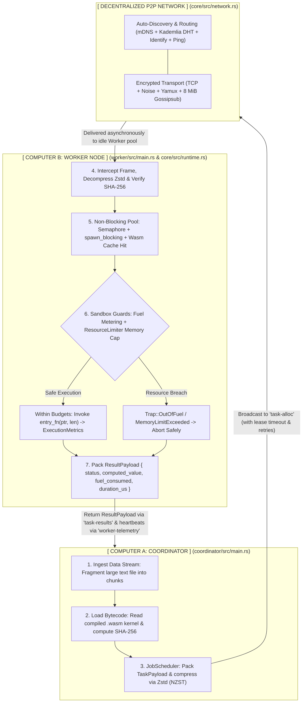
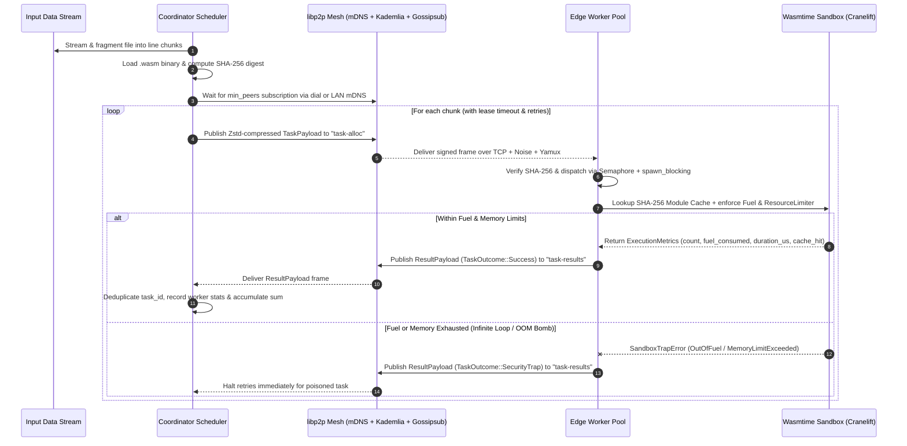

<div align="center">

# NITRO COMPUTE

### Decentralized P2P Serverless MapReduce Engine at the Edge

*Compile compute kernels into lightweight, sandboxed WebAssembly modules and orchestrate ultra-low latency big data workloads across an encrypted peer-to-peer mesh.*

[](https://www.rust-lang.org/)
[](https://wasmtime.dev/)
[](https://libp2p.io/)
[](https://tokio.rs/)
[](https://wasi.dev/)

---

[**Architecture**](#end-to-end-execution-pipeline) •
[**Security & Resource Limits**](#zero-trust-sandbox--deterministic-resource-guards) •
[**P2P Protocol**](#decentralized-p2p-wire-protocol) •
[**Workspace**](#workspace-architecture) •
[**Quick Start**](#quick-start--deployment) •
[**CLI Reference**](#cli-reference) •
[**Contributing**](#contributing)

</div>

---

## Overview

**Nitro Compute** is a high-performance, decentralized serverless compute engine written in **Rust**. Instead of shipping massive datasets to centralized cloud clusters or spinning up heavy container images, Nitro Compute compiles stateless MapReduce functions into compact **`wasm32-wasip1` WebAssembly bytecode** (~13 KB – 68 KB), compresses payloads with **Zstandard**, and streams them alongside fragmented data chunks across a **decentralized `libp2p` mesh network**.

Idle edge nodes (**Workers**) auto-discover peers via **mDNS** or **Kademlia DHT**, verify **SHA-256** bytecode integrity, cache compiled **Wasmtime (Cranelift)** modules for sub-millisecond cold starts, execute workloads inside non-blocking bounded thread pools guarded by **Instruction Fuel Metering** and **`ResourceLimiter` memory caps**, and stream telemetry-rich results back to the **Coordinator Oracle** over encrypted **Noise + Yamux** channels.

### Why Nitro Compute?

| Capability | Traditional Cloud MapReduce | Containerized Edge Workers | **Nitro Compute** |
| :--- | :--- | :--- | :--- |
| **Cold-Start Latency** | Seconds to Minutes (JVM / VM boot) | Hundreds of milliseconds | **< 1 ms (SHA-256 Cached Cranelift JIT)** |
| **Network Topology** | Centralized Master / Broker | Centralized API Gateway | **100% Decentralized P2P (`libp2p`)** |
| **Discovery & Routing** | Static Cluster DNS | Central Registry | **Kademlia DHT + mDNS + Identify + Ping** |
| **Untrusted Code Safety** | OS-level VM / Container | Namespace / cgroups | **WASI Sandbox + `ResourceLimiter` Memory Cap** |
| **Anti-Infinite Loop Protection** | Wall-clock OS timeout | CPU cgroup throttling | **Deterministic Fuel Metering (`Trap::OutOfFuel`)** |
| **Wire Compression & Fault Tolerance** | Raw JSON/RPC | Broker queues | **Zstd (`NZST`) Framing + Lease Retry Scheduler** |
| **Payload Footprint** | 100 MB – 2 GB container image | 50 MB – 500 MB image | **~13 KB – 68 KB `.wasm` binary** |

---

## End-to-End Execution Pipeline

### System Dataflow Blueprint



### Interactive Sequence Diagram



---

## Zero-Trust Sandbox & Deterministic Resource Guards

Executing arbitrary network-delivered compute kernels on peer nodes requires defense against **CPU infinite loops**, **OOM memory bombs**, and **memory corruption**.

Inside [`core/src/runtime.rs`](./core/src/runtime.rs), `NitroRuntime` enforces four layers of defense:

1. **Cranelift High-Speed JIT & SHA-256 Module Cache**:
   - Configured with `Strategy::Cranelift` and `OptLevel::Speed`.
   - Caches compiled `wasmtime::Module` instances in an LRU-evicting `RwLock<HashMap<[u8; 32], CachedModule>>` keyed by SHA-256, eliminating repeat JIT compilation latency across chunks.
2. **Deterministic Instruction Fuel Metering**:
   - Enabled globally via `config.consume_fuel(true)` and provisioned per store via `store.add_fuel(fuel_limit)?`.
   - Any guest exceeding its budget raises `Trap::OutOfFuel`, mapped to `SandboxTrapError::OutOfFuel`.
3. **Linear Memory & Table `ResourceLimiter`**:
   - Every `Store<SandboxState>` attaches `SandboxLimiter` (`wasmtime::ResourceLimiter`) enforcing `max_memory_bytes` (default `64 MiB`) and `max_table_elements` (default `10,000`).
   - Attempts by untrusted bytecode to execute oversized `memory.grow` or `table.grow` operations trap immediately with `SandboxTrapError::MemoryLimitExceeded` or `TableLimitExceeded`.
4. **Capability-Based WASI Sandboxing**:
   - Each execution spawns a fresh `WasiP1Ctx` without host directory preopens or raw socket permissions.

```rust
// core/src/runtime.rs
let mut config = Config::new();
config.strategy(Strategy::Cranelift);
config.cranelift_opt_level(OptLevel::Speed);
config.consume_fuel(true);
```

---

## Decentralized P2P Wire Protocol

The networking layer in [`core/src/network.rs`](./core/src/network.rs) defines `NitroBehavior`, combining **Kademlia DHT**, **Gossipsub**, **mDNS** (`Toggle<mdns::tokio::Behaviour>`), **Identify**, and **Ping**.

### Transport & Framing Stack
- **Transport**: Asynchronous TCP (`libp2p::tcp::tokio`)
- **Encryption**: Cryptographically authenticated **Noise** handshakes (`libp2p::noise`)
- **Multiplexing**: Concurrent stream multiplexing via **Yamux** (`libp2p::yamux`)
- **Compression & Frame Guard**: `NZST`-prefixed **Zstandard** wire compression with `8 MiB` Gossipsub `max_transmit_size` and `16 MiB` bounded decompression limit
- **Message Authenticity**: Cryptographically signed Gossipsub frames (`MessageAuthenticity::Signed(keypair)`) under `ValidationMode::Strict`

### Pub/Sub Topics & Wire Payloads

#### 1. Topic `"task-alloc"` (`Coordinator ──► Workers`)
```json
{
  "task_id": "job-a1b2c3d4-task-0",
  "job_id": "job-a1b2c3d4",
  "entry_fn": "map_line",
  "wasm_binary": [0, 97, 115, 109, 1, 0, 0, 0],
  "wasm_sha256": "a1b2c3d4...",
  "data_chunk": "distributed serverless mapreduce on webassembly edge nodes",
  "fuel": 10000000,
  "max_memory_bytes": 67108864,
  "attempt": 1
}
```

#### 2. Topic `"task-results"` (`Workers ──► Coordinator`)
```json
{
  "task_id": "job-a1b2c3d4-task-0",
  "job_id": "job-a1b2c3d4",
  "worker_peer_id": "12D3KooW...",
  "computed_value": 7,
  "status": "Success",
  "fuel_consumed": 1842,
  "duration_us": 312,
  "cache_hit": true,
  "attempt": 1
}
```

#### 3. Topic `"worker-telemetry"` (`Workers ──► Mesh`)
```json
{
  "worker_peer_id": "12D3KooW...",
  "active_tasks": 2,
  "completed_tasks": 148,
  "trapped_tasks": 1,
  "cached_modules": 2,
  "uptime_secs": 3600
}
```

---

## Workspace Architecture

```text
nitro-compute/
├── Cargo.toml                  # Workspace manifest & shared dependency versions
├── Cargo.lock                  # Reproducible dependency lockfile
├── core/                       # Shared runtime & P2P networking library (`nitro_core`)
│   ├── Cargo.toml
│   ├── src/
│   │   ├── lib.rs              # Public exports & unified tracing stdout subscriber
│   │   ├── runtime.rs          # NitroRuntime: Wasmtime + Fuel + ResourceLimiter + SHA-256 Cache
│   │   └── network.rs          # NitroBehavior: Kademlia + Gossipsub + mDNS + Identify + Ping + Zstd
│   └── tests/
│       └── p2p_mapreduce.rs    # Live 2-Swarm Noise+Yamux E2E P2P MapReduce & Trap test
├── coordinator/                # Fault-tolerant Coordinator CLI oracle & reducer
│   ├── Cargo.toml
│   └── src/
│       └── main.rs             # Stream chunker, JobScheduler with retries & telemetry summary
├── worker/                     # Non-blocking edge compute daemon
│   ├── Cargo.toml
│   └── src/
│       └── main.rs             # Semaphore-bounded blocking Wasm pool, cache & heartbeats
└── jobs/
    ├── word-count/             # Word-count Wasm kernel (`wasm32-wasip1`)
    │   ├── .cargo/config.toml
    │   ├── Cargo.toml
    │   └── src/lib.rs          # Exports: alloc, dealloc, map_line
    └── pattern-match/          # Multi-entrypoint log analyzer Wasm kernel (`wasm32-wasip1`)
        ├── .cargo/config.toml
        ├── Cargo.toml
        └── src/lib.rs          # Exports: alloc, dealloc, map_line, count_lines, count_chars
```

| Module | Crate Type | Key Responsibilities |
| :--- | :--- | :--- |
| **[`core`](./core)** (`nitro_core`) | `lib` | Encapsulates `NitroRuntime` (Cranelift + Fuel + `ResourceLimiter` + SHA-256 Cache) and `NitroBehavior` (`libp2p` + Zstd wire framing + mDNS/Identify/Ping). |
| **[`coordinator`](./coordinator)** | `bin` | Streams files, waits for mDNS/dial workers, manages `JobScheduler` leases & retries, halts poisoned security-trapped jobs, and prints aggregate metrics. |
| **[`worker`](./worker)** | `bin` | Runs a non-blocking `tokio::task::spawn_blocking` pool bounded by `Semaphore`, caches verified `.wasm` artifacts, and emits `ResultPayload` + `WorkerTelemetry`. |
| **[`jobs/word-count`](./jobs/word-count)** | `cdylib`, `rlib` | Counts whitespace-delimited words over linear memory (`map_line`). |
| **[`jobs/pattern-match`](./jobs/pattern-match)** | `cdylib`, `rlib` | Multi-entrypoint log anomaly & metrics kernel (`map_line`, `count_lines`, `count_chars`). |

---

## Quick Start & Deployment

### Prerequisites
- **Rust Toolchain** (`rustc` & `cargo` 2021 edition)
- **WASI Preview 1 Target**:
  ```bash
  rustup target add wasm32-wasip1
  ```

### Step 1: Compile the WebAssembly MapReduce Jobs
```bash
cargo build --manifest-path jobs/word-count/Cargo.toml --target wasm32-wasip1 --release
cargo build --manifest-path jobs/pattern-match/Cargo.toml --target wasm32-wasip1 --release
```

### Step 2: Run Tests and Build Workspace Binaries
```bash
cargo test --workspace
cargo build --release
```

### Step 3: Start Edge Worker Nodes (Zero-Config LAN mDNS or Explicit Listen Port)
```bash
RUST_LOG=info cargo run --release --bin worker -- \
  --listen /ip4/0.0.0.0/tcp/4001 \
  --max-concurrency 4 \
  --max-memory-mb 64
```

### Step 4: Dispatch a MapReduce Job from the Coordinator
Create `input.txt` and run the Coordinator (discovers local workers automatically via mDNS, or pass `--peer`):
```bash
RUST_LOG=info cargo run --release --bin coordinator -- \
  --input input.txt \
  --wasm target/wasm32-wasip1/release/word_count.wasm \
  --peer /ip4/127.0.0.1/tcp/4001 \
  --chunk-lines 5 \
  --fuel 10000000 \
  --max-memory-mb 64 \
  --retries 2 \
  --task-timeout 10 \
  --timeout 30
```

To run log anomaly detection with `jobs/pattern-match` (or select `--entry-fn count_lines` / `count_chars`):
```bash
RUST_LOG=info cargo run --release --bin coordinator -- \
  --input server.log \
  --wasm target/wasm32-wasip1/release/pattern_match.wasm \
  --entry-fn map_line \
  --chunk-lines 20
```

---

## CLI Reference

### `coordinator` Flags

| Flag | Short | Default | Description |
| :--- | :---: | :--- | :--- |
| `--input <PATH>` | `-i` | `input.txt` | Path to the raw text stream file to fragment and process. |
| `--wasm <PATH>` | `-w` | Auto-detected | Explicit path to the compiled `.wasm` MapReduce module. |
| `--entry-fn <NAME>` | `-e` | `map_line` | Exported Wasm function name to invoke per chunk. |
| `--listen <MULTIADDR>` | `-l` | `/ip4/0.0.0.0/tcp/0` | Local TCP multiaddr for the Coordinator node. |
| `--peer <MULTIADDR>` | `-p` | Auto (mDNS) | Worker peer multiaddr to dial (repeatable). |
| `--chunk-lines <N>` | `-c` | `1` | Number of non-empty lines bundled into each `TaskPayload`. |
| `--fuel <UNITS>` | `-f` | `10000000` | Maximum Wasmtime instruction fuel granted per task chunk. |
| `--max-memory-mb <MB>` | `-m` | `64` | Maximum linear memory (MiB) enforced by `ResourceLimiter`. |
| `--retries <N>` | `-r` | `2` | Maximum re-dispatch retries for timed-out or transient-failed tasks. |
| `--task-timeout <SECS>` | — | `10` | Per-attempt lease timeout before re-broadcasting a chunk. |
| `--timeout <SECS>` | `-t` | `30` | Maximum overall deadline (seconds) to complete the job. |
| `--min-peers <N>` | — | `1` | Minimum `"task-alloc"` subscribers to wait for before dispatching. |
| `--discovery-timeout <SECS>` | — | `10` | Time window (seconds) to wait for mDNS/dial worker discovery. |
| `--no-mdns` | — | `false` | Disable LAN mDNS peer discovery. |

### `worker` Flags

| Flag | Short | Default | Description |
| :--- | :---: | :--- | :--- |
| `--listen <MULTIADDR>` | `-l` | `/ip4/0.0.0.0/tcp/0` | Local TCP multiaddr for the Worker daemon to bind. |
| `--peer <MULTIADDR>` | `-p` | Auto (mDNS) | Optional bootstrap peer multiaddr to dial on startup. |
| `--max-concurrency <N>` | `-j` | CPU cores | Maximum concurrent Wasm sandbox executions in the blocking pool. |
| `--max-memory-mb <MB>` | `-m` | `64` | Hard linear memory ceiling (MiB) enforced per sandbox instance. |
| `--telemetry-interval <SECS>` | — | `10` | Interval (seconds) between `"worker-telemetry"` heartbeats. |
| `--no-mdns` | — | `false` | Disable LAN mDNS peer discovery. |

---

## Documentation & Governance

| Document | Description |
| :--- | :--- |
| **[`ARCHITECTURE.md`](./ARCHITECTURE.md)** | Deep-dive specification of the Wasmtime sandbox, `ResourceLimiter`, SHA-256 cache, and `libp2p` mesh protocol. |
| **[`SECURITY.md`](./SECURITY.md)** | Threat model, defense-in-depth controls (`OutOfFuel`, `MemoryLimitExceeded`, Zstd bounds, Noise encryption), and disclosure policy. |
| **[`CONTRIBUTING.md`](./CONTRIBUTING.md)** | Contributor workflow, guide for authoring new `wasm32-wasip1` job kernels, and PR verification standards. |
| **[`CODE_OF_CONDUCT.md`](./CODE_OF_CONDUCT.md)** | Community standards based on the Contributor Covenant v2.1. |
| **[`CHANGELOG.md`](./CHANGELOG.md)** | Version history and release notes following Keep a Changelog. |
| **[`LICENSE`](./LICENSE)** | Repository open-source license terms. |

---

## Contributing

Contributions to **Nitro Compute** are welcome—whether improving P2P routing resilience, optimizing Wasmtime linear memory zero-copy transfers, or authoring new `wasm32-wasip1` compute kernels.

### Development Workflow

1. **Fork and Clone the Repository**
   ```bash
   git clone https://github.com/AM4517UMOR4NG/Nitro-Compute.git
   cd Nitro-Compute
   ```

2. **Create a Feature or Fix Branch**
   ```bash
   git checkout -b feat/your-feature-name
   ```

3. **Authoring New WebAssembly Job Kernels (`jobs/<job-name>`)**
   Every guest compute module under `jobs/` must compile to `wasm32-wasip1` (`crate-type = ["cdylib", "rlib"]`) and adhere to the sandbox ABI contract:
   - Export `#[no_mangle] pub extern "C" fn alloc(len: usize) -> *mut u8`
   - Export `#[no_mangle] pub extern "C" fn dealloc(ptr: *mut u8, len: usize)`
   - Export `#[no_mangle] pub extern "C" fn map_line(ptr: *const u8, len: usize) -> usize`

4. **Run Pre-Submission Verification**
   Ensure formatting, lint checks, tests, and release builds pass with zero warnings:
   ```bash
   cargo fmt --all -- --check
   cargo clippy --workspace --all-targets -- -D warnings
   cargo test --workspace
   cargo build --manifest-path jobs/word-count/Cargo.toml --target wasm32-wasip1 --release
   cargo build --manifest-path jobs/pattern-match/Cargo.toml --target wasm32-wasip1 --release
   cargo build --release
   ```

5. **Commit Using Conventional Commits**
   Follow the [Conventional Commits](https://www.conventionalcommits.org/) specification (`feat:`, `fix:`, `security:`, `refactor:`, `perf:`, `docs:`, `chore:`) and open a Pull Request against `main`.

### Contributors

<a href="https://github.com/AM4517UMOR4NG/Nitro-Compute/graphs/contributors">
  
</a>

---

## License

Distributed under the terms of the repository [LICENSE](./LICENSE).
