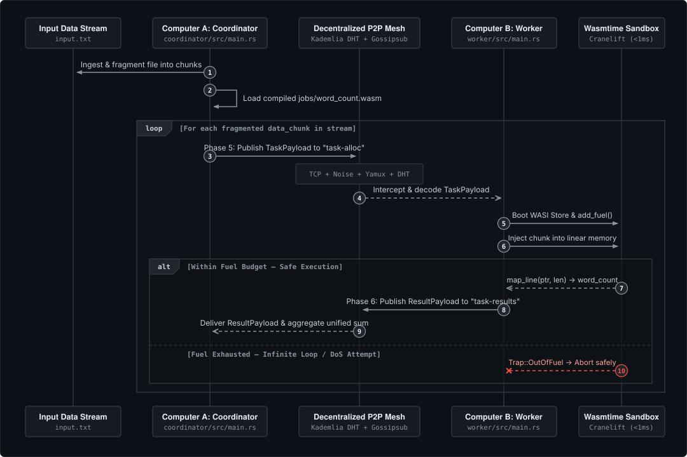
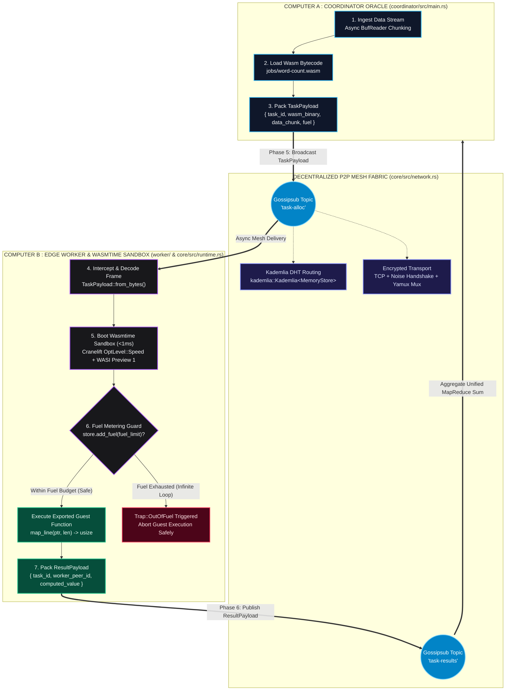
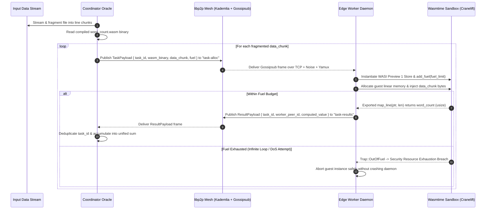

<div align="center">

# NITRO COMPUTE

### Decentralized P2P Serverless MapReduce Engine at the Edge

*Compile compute kernels into lightweight, sandboxed WebAssembly modules and orchestrate ultra-low latency big data workloads across an encrypted peer-to-peer mesh.*

[](https://www.rust-lang.org/)
[](https://wasmtime.dev/)
[](https://libp2p.io/)
[](https://tokio.rs/)
[](https://wasi.dev/)

---

[**Architecture**](#end-to-end-execution-pipeline) •
[**Security & Fuel Metering**](#zero-trust-sandbox--deterministic-fuel-metering) •
[**P2P Protocol**](#decentralized-p2p-wire-protocol) •
[**Workspace**](#workspace-architecture) •
[**Quick Start**](#quick-start--deployment) •
[**CLI Reference**](#cli-reference) •
[**Contributing**](#contributing)

</div>

---

## Overview

**Nitro Compute** is a high-performance, decentralized serverless compute engine written in **Rust**. Instead of shipping massive datasets to centralized cloud clusters or spinning up heavy container images, Nitro Compute compiles stateless MapReduce functions into compact **`wasm32-wasi` WebAssembly bytecode** and streams them alongside fragmented data chunks across a **decentralized `libp2p` mesh network**.

Idle edge nodes (**Workers**) intercept task broadcasts, instantiate hardware-accelerated **Wasmtime (Cranelift)** sandboxes in sub-millisecond cold starts, enforce strict instruction-level **Fuel Metering** against infinite loops, and stream partial reductions back to the **Coordinator Oracle** over encrypted **Noise + Yamux** channels.

### Why Nitro Compute?

| Capability | Traditional Cloud MapReduce | Containerized Edge Workers | **Nitro Compute** |
| :--- | :--- | :--- | :--- |
| **Cold-Start Latency** | Seconds to Minutes (JVM / VM boot) | Hundreds of milliseconds | **< 1 ms (Wasmtime Cranelift JIT)** |
| **Network Topology** | Centralized Master / Broker | Centralized API Gateway | **100% Decentralized P2P (`libp2p`)** |
| **Discovery & Routing** | Static Cluster DNS | Central Registry | **Kademlia DHT + Gossipsub Mesh** |
| **Untrusted Code Safety** | OS-level VM / Container | Namespace / cgroups | **Capability-based WASI + Linear Memory Isolation** |
| **Anti-Infinite Loop Protection** | Wall-clock OS timeout | CPU cgroup throttling | **Deterministic WASM Instruction Fuel Metering (`Trap::OutOfFuel`)** |
| **Payload Footprint** | 100 MB – 2 GB container image | 50 MB – 500 MB image | **~10 KB – 150 KB `.wasm` binary** |

---

## End-to-End Execution Pipeline

### System Dataflow Blueprint

<div align="center">
  
</div>

### Topological Architecture Graph



### Interactive Sequence Diagram



---

## Zero-Trust Sandbox & Deterministic Fuel Metering

Executing arbitrary user-supplied compute kernels on peer nodes requires strict isolation against both **memory corruption** and **algorithmic Denial-of-Service (infinite loops)**.

Inside [`core/src/runtime.rs`](./core/src/runtime.rs), `NitroRuntime` enforces three layers of defense:

1. **Cranelift High-Speed JIT Compilation**:
   - Configured with `Strategy::Cranelift` and `OptLevel::Speed` to leverage hardware guard pages for near-native bounds-checked linear memory access.
2. **Capability-Based WASI Sandboxing**:
   - Each task invocation spawns a fresh, ephemeral `Store<WasiP1Ctx>` with no ambient filesystem or network socket access.
   - Host-to-guest data transfer uses explicit guest heap allocation (`alloc` / `dealloc`) and bounds-checked `Memory::write` before invoking `map_line(ptr, len)`.
3. **Deterministic Instruction Fuel Metering**:
   - Enabled globally on the engine via `config.consume_fuel(true)` and provisioned per execution store via `store.add_fuel(fuel_limit)?`.
   - Every Wasm instruction decrements the store's fuel counter. If untrusted bytecode enters an infinite loop or exceeds its budget, Wasmtime immediately raises `Trap::OutOfFuel`, which `NitroRuntime::classify_execution_error` intercepts and converts into a structured security breach error.

```rust
// core/src/runtime.rs
let mut config = Config::new();
config.strategy(Strategy::Cranelift);
config.cranelift_opt_level(OptLevel::Speed);
config.consume_fuel(true);
```

---

## Decentralized P2P Wire Protocol

The networking layer in [`core/src/network.rs`](./core/src/network.rs) combines **Kademlia DHT** (`kad::Behaviour<MemoryStore>`) and **Gossipsub** (`gossipsub::Behaviour`) inside `#[derive(NetworkBehavior)] pub struct NitroBehavior`.

### Transport Stack
- **Transport**: Asynchronous TCP (`libp2p::tcp::tokio`)
- **Encryption**: Cryptographically authenticated **Noise** handshakes (`libp2p::noise`)
- **Multiplexing**: Concurrent stream multiplexing via **Yamux** (`libp2p::yamux`)
- **Message Authenticity**: Cryptographically signed Gossipsub frames (`MessageAuthenticity::Signed(keypair)`) with strict validation (`ValidationMode::Strict`)

### Pub/Sub Topics & Wire Payloads

#### 1. Topic `"task-alloc"` (`Coordinator ──► Workers`)
```json
{
  "task_id": "task-0",
  "wasm_binary": [0, 97, 115, 109, 1, 0, 0, 0, "..."],
  "data_chunk": "distributed serverless mapreduce on webassembly edge nodes",
  "fuel": 10000000
}
```

#### 2. Topic `"task-results"` (`Workers ──► Coordinator`)
```json
{
  "task_id": "task-0",
  "worker_peer_id": "12D3KooW...",
  "computed_value": 7
}
```

---

## Workspace Architecture

```text
nitro-compute/
├── Cargo.toml                  # Workspace manifest & shared dependency versions
├── Cargo.lock                  # Reproducible dependency lockfile
├── core/                       # Shared runtime & P2P networking library
│   ├── Cargo.toml
│   └── src/
│       ├── lib.rs              # Public exports & unified tracing stdout subscriber
│       ├── runtime.rs          # NitroRuntime: Wasmtime + WASI + Fuel Metering
│       └── network.rs          # NitroBehavior: Kademlia + Gossipsub + Wire Payloads
├── coordinator/                # Network entry oracle & MapReduce aggregator CLI
│   ├── Cargo.toml
│   └── src/
│       └── main.rs             # Stream chunker, "task-alloc" publisher & "task-results" reducer
├── worker/                     # Edge compute listener daemon
│   ├── Cargo.toml
│   └── src/
│       └── main.rs             # Intercepts tasks, runs Wasm sandbox & returns ResultPayloads
└── jobs/
    └── word-count/             # Sandboxed WebAssembly MapReduce guest module
        ├── .cargo/config.toml  # Default build target: wasm32-wasi
        ├── Cargo.toml          # crate-type = ["cdylib", "rlib"]
        └── src/
            └── lib.rs          # #[no_mangle] exports: alloc, dealloc, map_line
```

| Module | Crate Type | Key Responsibilities |
| :--- | :--- | :--- |
| **[`core`](./core)** | `lib` | Encapsulates `NitroRuntime` (`wasmtime` + `wasmtime-wasi`) and `NitroBehavior` (`libp2p`), wire schemas (`TaskPayload`, `ResultPayload`), and structured `tracing` telemetry. |
| **[`coordinator`](./coordinator)** | `bin` | Streams input text files, fragments lines into chunks, loads compiled `.wasm` jobs, broadcasts `TaskPayload`s onto `"task-alloc"`, and aggregates `ResultPayload`s from `"task-results"`. |
| **[`worker`](./worker)** | `bin` | Runs an asynchronous `libp2p` Swarm daemon, decodes incoming `TaskPayload`s, executes `"map_line"` inside fuel-metered Wasm sandboxes, and publishes `ResultPayload`s. |
| **[`jobs/word-count`](./jobs/word-count)** | `cdylib`, `rlib` | Guest compute module compiled to `wasm32-wasi` that exposes linear memory management (`alloc`, `dealloc`) and word-counting (`map_line`). |

---

## Quick Start & Deployment

### Prerequisites
- **Rust Toolchain** (`rustc` & `cargo` 2021 edition)
- **WASI Target**:
  ```bash
  rustup target add wasm32-wasi
  ```

### Step 1: Compile the WebAssembly MapReduce Job
Compile `jobs/word-count` into a standalone `.wasm` binary:
```bash
cargo build --manifest-path jobs/word-count/Cargo.toml --target wasm32-wasi --release
```

### Step 2: Compile the Workspace Binaries (`coordinator` & `worker`)
```bash
cargo build --release
```

### Step 3: Start an Edge Worker Node (Terminal 1)
Launch one or more worker daemons listening on a TCP multiaddr:
```bash
RUST_LOG=info cargo run --release --bin worker -- --listen /ip4/0.0.0.0/tcp/4001
```
**Sample Worker Output:**
```text
INFO core::runtime: Initialized NitroRuntime with Cranelift (OptLevel::Speed) and WASM fuel metering enabled
INFO core::network: Initialized libp2p Swarm subscribed to bidirectional Gossipsub topics local_peer_id=12D3KooW... alloc_topic="task-alloc" results_topic="task-results"
INFO core::network: Swarm listening on local multiaddr address=/ip4/127.0.0.1/tcp/4001
INFO worker: Worker daemon ready and listening for MapReduce TaskPayloads
```

### Step 4: Dispatch a MapReduce Job from the Coordinator (Terminal 2)
Create a sample dataset `input.txt` and run the Coordinator Oracle dialing the worker's multiaddr:
```bash
RUST_LOG=info cargo run --release --bin coordinator -- \
  --input input.txt \
  --wasm target/wasm32-wasi/release/word_count.wasm \
  --peer /ip4/127.0.0.1/tcp/4001 \
  --chunk-lines 5 \
  --fuel 10000000 \
  --timeout 30
```
**Sample Coordinator Output:**
```text
INFO coordinator: Starting nitro-compute coordinator oracle... fuel_limit=10000000
INFO coordinator: Discovered compiled word-count Wasm binary path=target/wasm32-wasi/release/word_count.wasm
INFO coordinator: Fragmented input text stream into MapReduce chunks total_chunks=4
INFO coordinator: Broadcasted TaskPayload to Gossipsub mesh task_id="task-0" fuel=10000000 topic="task-alloc"
INFO coordinator: Received worker ResultPayload and updated aggregate sum task_id="task-0" computed_value=42 unified_sum=42 remaining_tasks=3
...
INFO coordinator: All dispatched MapReduce tasks completed and aggregated unified_sum=184
INFO coordinator: Final aggregated MapReduce word count sum: 184
```

---

## CLI Reference

### `coordinator` Flags

| Flag | Short | Default | Description |
| :--- | :---: | :--- | :--- |
| `--input <PATH>` | `-i` | `input.txt` | Path to the raw text stream file to fragment and process. |
| `--wasm <PATH>` | `-w` | Auto-detected | Explicit path to the compiled `.wasm` MapReduce module. |
| `--listen <MULTIADDR>` | `-l` | `/ip4/0.0.0.0/tcp/0` | Local TCP multiaddr for the Coordinator node. |
| `--peer <MULTIADDR>` | `-p` | — | Worker peer multiaddr to dial (can be specified multiple times). |
| `--chunk-lines <N>` | `-c` | `1` | Number of non-empty lines bundled into each `TaskPayload`. |
| `--fuel <UNITS>` | `-f` | `10000000` | Maximum Wasmtime instruction fuel granted per task chunk. |
| `--timeout <SECS>` | `-t` | `30` | Maximum time window (seconds) to await worker `ResultPayload`s. |

### `worker` Flags

| Flag | Short | Default | Description |
| :--- | :---: | :--- | :--- |
| `--listen <MULTIADDR>` | `-l` | `/ip4/0.0.0.0/tcp/0` | Local TCP multiaddr for the Worker daemon to bind. |
| `--peer <MULTIADDR>` | `-p` | — | Optional bootstrap peer multiaddr to dial on startup. |

---

## Documentation & Governance

| Document | Description |
| :--- | :--- |
| **[`ARCHITECTURE.md`](./ARCHITECTURE.md)** | Deep-dive specification of the Wasmtime sandbox, linear memory ABI, and `libp2p` mesh protocol. |
| **[`SECURITY.md`](./SECURITY.md)** | Threat model, defense-in-depth controls (`Trap::OutOfFuel`, WASI isolation, Noise encryption), and disclosure policy. |
| **[`CONTRIBUTING.md`](./CONTRIBUTING.md)** | Contributor workflow, guide for authoring new `wasm32-wasi` job kernels, and PR verification standards. |
| **[`CODE_OF_CONDUCT.md`](./CODE_OF_CONDUCT.md)** | Community standards based on the Contributor Covenant v2.1. |
| **[`CHANGELOG.md`](./CHANGELOG.md)** | Version history and release notes following Keep a Changelog. |
| **[`LICENSE`](./LICENSE)** | Repository open-source license terms. |

---

## Contributing

Contributions to **Nitro Compute** are welcome—whether improving P2P routing resilience, optimizing Wasmtime linear memory zero-copy transfers, or authoring new `wasm32-wasi` compute kernels.

### Development Workflow

1. **Fork and Clone the Repository**
   ```bash
   git clone https://github.com/AM4517UMOR4NG/Nitro-Compute.git
   cd Nitro-Compute
   ```

2. **Create a Feature or Fix Branch**
   ```bash
   git checkout -b feat/your-feature-name
   ```

3. **Authoring New WebAssembly Job Kernels (`jobs/<job-name>`)**
   Every guest compute module under `jobs/` must compile to `wasm32-wasi` (`crate-type = ["cdylib", "rlib"]`) and adhere to the sandbox ABI contract:
   - Export `#[no_mangle] pub extern "C" fn alloc(len: usize) -> *mut u8`
   - Export `#[no_mangle] pub extern "C" fn dealloc(ptr: *mut u8, len: usize)`
   - Export `#[no_mangle] pub extern "C" fn map_line(ptr: *const u8, len: usize) -> usize`

4. **Run Pre-Submission Verification**
   Ensure formatting, lint checks, and release builds pass with zero warnings:
   ```bash
   cargo fmt --all -- --check
   cargo clippy --workspace --all-targets -- -D warnings
   cargo build --manifest-path jobs/word-count/Cargo.toml --target wasm32-wasi --release
   cargo build --release
   ```

5. **Commit Using Conventional Commits**
   Follow the [Conventional Commits](https://www.conventionalcommits.org/) specification (`feat:`, `fix:`, `security:`, `refactor:`, `perf:`, `docs:`, `chore:`) and open a Pull Request against `main`.

### Contributors

<a href="https://github.com/AM4517UMOR4NG/Nitro-Compute/graphs/contributors">
  
</a>

---

## License

Distributed under the terms of the repository [LICENSE](./LICENSE).
